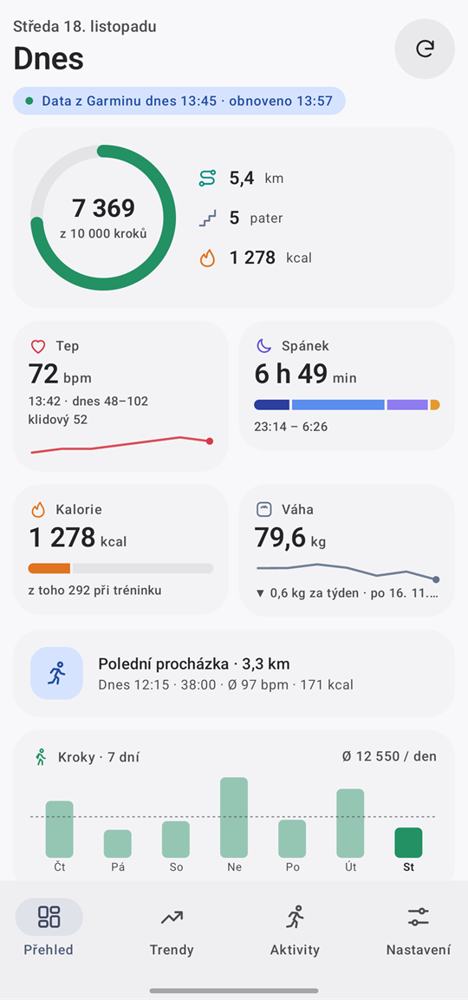
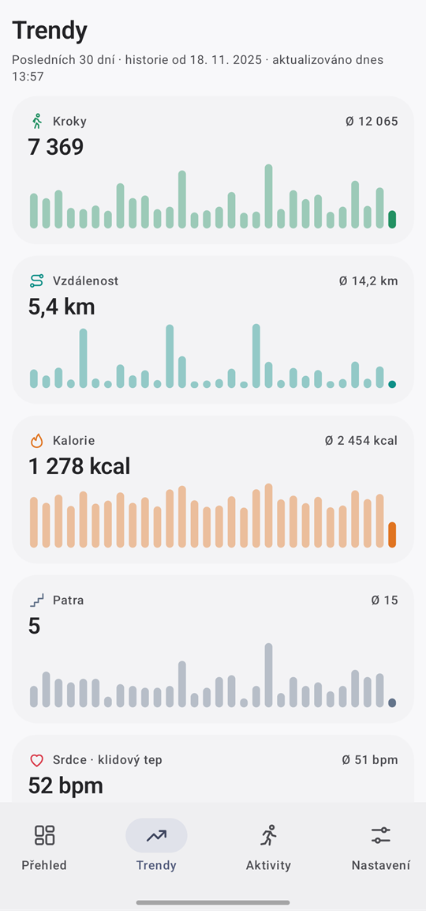
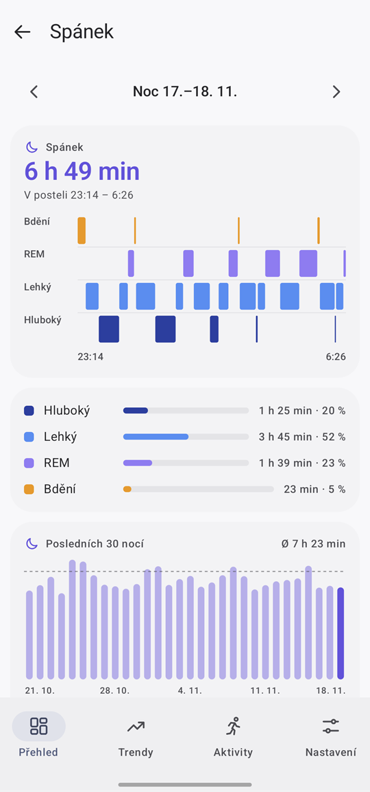
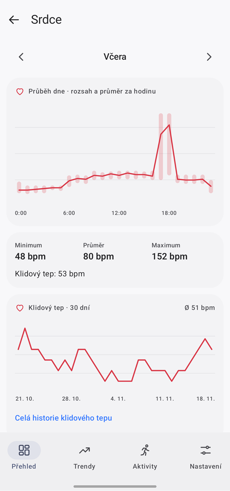
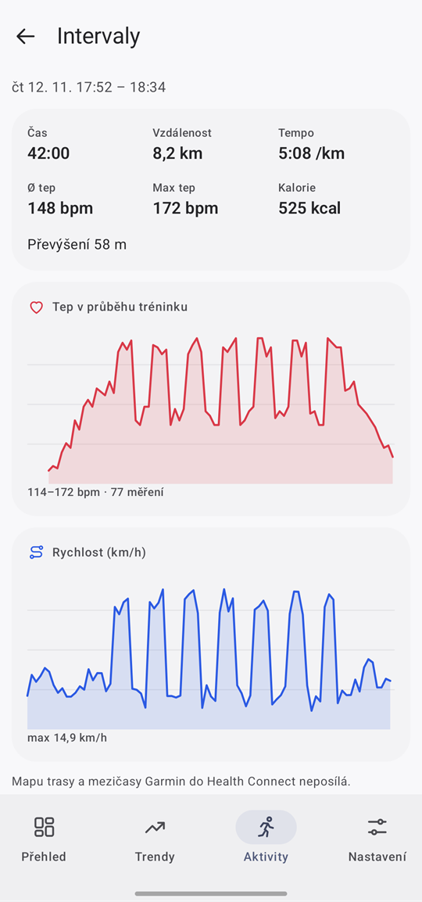
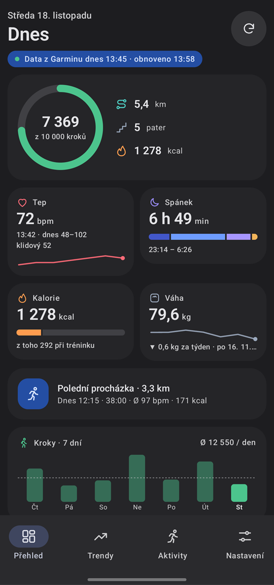
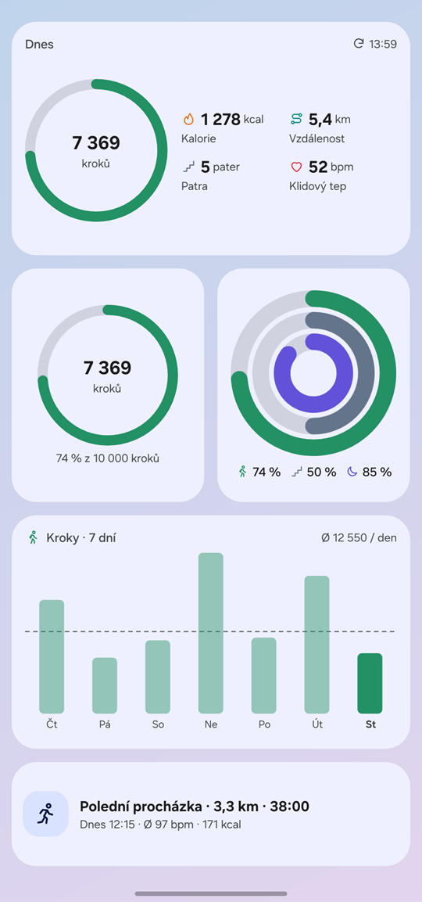
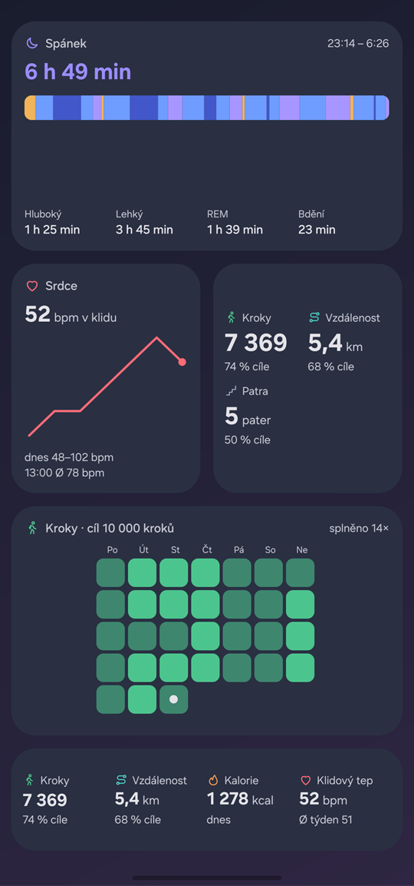
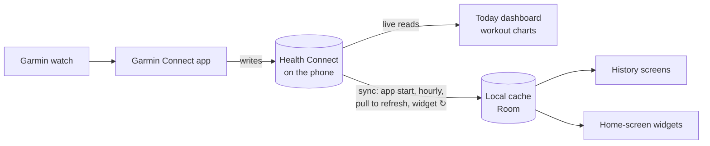

# HealthWidgy

**Your Garmin data on your Android home screen.**

HealthWidgy is a small Android app that shows what your Garmin watch records: steps, heart rate, sleep, workouts and weight. It has a clean "Today" dashboard, history screens and eleven home-screen widgets.

It reads only the data that the Garmin Connect app already shares with **Android Health Connect**. Everything stays on the phone, and the app has no internet permission.


> [!NOTE]
> The app's interface is in Czech. All screenshots use **generated demo data**, not a real person's health data (see [Demo build](#demo-build)).

<table>
  <tr>
    <td align="center"><br><sub><b>Today</b>: live from Health Connect</sub></td>
    <td align="center"><br><sub><b>Trends</b>: the last 30 days</sub></td>
    <td align="center"><br><sub><b>Sleep</b>: stages and the last 30 nights</sub></td>
  </tr>
  <tr>
    <td align="center"><br><sub><b>Heart</b>: the day hour by hour, resting heart rate</sub></td>
    <td align="center"><br><sub><b>Workout</b>: pace, heart rate, speed</sub></td>
    <td align="center"><br><sub><b>Dark mode</b>, set per app or by the system</sub></td>
  </tr>
</table>

## Features

### Today
The **Přehled** (Overview) tab reads Health Connect live while the app is open.

- **Steps ring:** progress toward your step goal, with distance, floors and total calories next to it.
- **Tiles:**
  - current heart rate, today's range and resting heart rate;
  - last night's sleep with a stage bar;
  - active and total calories;
  - weight with its weekly change and body fat.
- **Latest workout** of the last 30 days.
- **Steps over the last 7 days**, with the goal line.
- **Data freshness:** a source pill shows when Garmin last wrote data. Pull down to refresh.

### History
History screens draw from a local cache, so they open instantly and also work while Health Connect is busy.

- **Trends:** the last 30 days of steps, distance, calories, floors, resting heart rate and sleep, plus 90 days of weight.
- **Metric detail:** a week, month or year view with averages, totals, best day and how often you met the goal.
- **Heart:** for each of the last 7 days, the hourly minimum, maximum and average, plus the 30-day resting heart rate.
- **Sleep:** a hypnogram of each night (deep, light, REM, awake), the time in each stage, and the last 30 nights against your sleep goal.
- **Body:** weight and body fat over 3 months or a year, from Garmin or any other app such as a smart scale's.
- **Activities:** workouts grouped by week. The workout detail shows time, distance, pace or speed, average and maximum heart rate, calories, elevation gain, and heart rate and speed charts.

### Home-screen widgets
Eleven widgets built with Jetpack Glance. Seven of them let you choose what they show, both when you place them and later.

<table>
  <tr>
    <td align="center"></td>
    <td align="center"></td>
  </tr>
</table>

| Widget | Size | What it shows | You choose |
|---|---|---|---|
| Today's overview *(Dnešní přehled)* | 4×2 | A goal ring and four values | The ring and all four values |
| Multiple values *(Více hodnot)* | 4×1 | Two to four values side by side, adapting to the size | Up to four values |
| Ring *(Kroužek)* | 2×2 | One goal with its percentage | Steps, distance, floors or sleep |
| Goal rings *(Kroužky cílů)* | 2×2 | Three concentric goal rings | Each ring |
| Trend | 4×2 | A bar or line chart with the average | Metric; 7, 14 or 30 days |
| Goal calendar *(Kalendář cíle)* | 4×2 | The last 5 weeks, day by day, shaded by goal completion | Steps, distance, floors or sleep |
| Single value *(Jedna hodnota)* | 2×1 | One value in large type | Any of the 9 metrics |
| Sleep *(Spánek)* | 4×2 | Last night's duration, times and stages | – |
| Heart *(Srdce)* | 2×2 | Resting heart rate and its 7-day trend | – |
| Heart rate today *(Tep dnes)* | 4×2 | Today's heart rate hour by hour | – |
| Latest activity *(Poslední aktivita)* | 4×1 | The latest workout | – |

You can choose from 9 metrics: steps, calories, distance, floors, resting heart rate, sleep, weight, heart rate in the last hour and body fat.

- **Tapping a widget** opens the matching screen in the app.
- **Refreshing:** widgets refresh after every sync:
  - about once an hour;
  - when the app opens;
  - when you pull down on the Today screen;
  - when you tap ↻ on the *Today's overview* or *Heart rate today* widget.
- **Theme:** widgets follow the system or stay light or dark. Their colours come from your wallpaper (Material You).
- **Previews:** on Android 15+ the widget picker shows previews drawn from your own data.

### Settings
- **Daily goals** for steps, distance, floors and sleep. Garmin does not share its goals with Health Connect, so you set them here.
- **Appearance:** System, Light or Dark, set separately for the app and for the widgets.
- **Widgets:** add any widget from inside the app and edit the ones already placed.
- **Data source:** Garmin Connect only (the default) or all apps in Health Connect.
- **Permissions:** how many data types are allowed and whether background reading and older data are on, with buttons to ask for what is missing.
- **Data inventory** *(Data v Health Connect)*: what each data type contains over the last 30 days, for example sources, devices, sample spacing and whether it is allowed.

## Where the data comes from



1. **Garmin Connect writes to Health Connect.** The watch syncs to the Garmin Connect app, which copies its data into Health Connect, Android's on-device health data store.
2. **HealthWidgy reads Health Connect and never writes to it.** It asks for 13 read permissions, which cover 14 data types (cycling cadence comes with the workouts permission):
   - steps, distance, floors and elevation gain;
   - active and total calories;
   - heart rate and resting heart rate;
   - sleep;
   - workouts, speed and cycling cadence;
   - weight and body fat.

   Two optional permissions add background reading, so widgets update while the app is closed, and history older than 30 days.
3. **Garmin-only by default.** Activity, heart and sleep data are filtered to Garmin Connect, so the phone's own step counter is not counted twice. Weight and body fat are taken from any app, because a scale often has its own app.
4. **A local cache feeds the history and widgets.** The first sync loads 30 days, or a full year with the history permission. Later syncs refresh the last few days, on app start and hourly in the background.

### What Garmin does not share
Health Connect has no place for some Garmin data, so the app cannot show it:
- HRV, stress and Body Battery;
- sleep score;
- routes and splits;
- daily goals.

### Privacy
- **No internet permission:** the app sends nothing anywhere.
- **No cloud backup:** the app's data is excluded from Google backup. A phone-to-phone transfer to a new device can still copy the local cache.
- **No account, no analytics.**
- **Revoking access:** you can revoke access at any time in the Health Connect settings.
- **The only export** is the data inventory JSON, and it leaves the phone only when you share it yourself.

## Requirements
- **Android 14 or newer.** Health Connect is part of the system there, and Garmin Connect writes to it only on Android 14+.
- **A Garmin watch and the Garmin Connect app,** with sharing to Health Connect turned on: *More → Settings → Connected apps → Health Connect*, all categories allowed.
- **Recommended:** allow *background reading* and *older data* when HealthWidgy asks.

## Install
There is no Play Store release; this is a personal project.

1. Build the APK from source (below).
2. Install it with `adb`.
3. On first start, a setup checklist walks you through Health Connect, Garmin Connect and the permissions.

## Build from source
**You need:** JDK 17 or newer, and the Android SDK with platform 37. Set its path with `ANDROID_HOME` or in `local.properties`.

```bash
./gradlew assembleDebug testDebugUnitTest
adb install -r app/build/outputs/apk/debug/app-debug.apk
```

**Unit tests:** run on the JVM (`app/src/test`). They cover formatting, the history helpers and the widget logic.

**Maven mirror:** `settings.gradle.kts` resolves Maven Central through Google's public mirror instead of `mavenCentral()`. It works from anywhere. You can switch it back if you prefer.

### Demo build
The **demo build** installs as a separate app, `cz.healthwidgy.demo`, next to the real one.

- **No real data involved.** Health Connect is replaced by a generated year of a fictional person's Garmin-like data: a weekly training plan, nightly sleep stages, and slowly trending weight and resting heart rate.
- **Everything else is the real app:** the same screens, sync and widgets. All screenshots in this README come from it.

```bash
./gradlew installDemo
adb shell am start -n cz.healthwidgy.demo/cz.healthwidgy.MainActivity
```

- **Opening a specific screen:** pass `--es cz.healthwidgy.OPEN <screen>`, where the screen is `sleep`, `heart`, `body`, `activities` or `metric:steps`.
- **Widget showcase:** the debug-only widget gallery renders a home-screen-like page of widgets.

```bash
adb shell am start -n cz.healthwidgy.demo/cz.healthwidgy.debug.WidgetGalleryActivity --es showcase 1
adb shell am start -n cz.healthwidgy.demo/cz.healthwidgy.debug.WidgetGalleryActivity --es showcase 2 --ez night true
```

Debug and demo builds also include an adb-only dump tool (`DebugDumpReceiver`) for inspecting raw Health Connect records.

## Project structure
```
app/src/main/kotlin/cz/healthwidgy/
├── data/      Health Connect access, Room cache, sync engine, settings
├── ui/        Compose screens: overview, history, settings, setup, inventory
└── widget/    Glance widgets, widget configuration, rendering
app/src/debug/ adb-only tools: data dumps, widget gallery
app/src/demo/  demo build: a fake Health Connect client with generated data
app/src/test/  JVM unit tests
```

**One UI note:** widgets are rendered in the app's own process and handed to the launcher directly. Samsung's One UI stops Glance's background render jobs about a second after the app leaves the screen, so widgets would otherwise keep their old content.

## Tech stack
| | |
|---|---|
| Language | Kotlin 2.4 |
| UI | Jetpack Compose, Material 3, Navigation 3 |
| Widgets | Jetpack Glance 1.2 |
| Health data | Health Connect client 1.1 |
| Storage | Room 2.8, DataStore |
| Background work | WorkManager 2.12 |
| Build | Android Gradle Plugin 9.5, Gradle 9.9 |
| SDK | min 34, target 36, compile 37 |

**Implementation notes:**
- **Dependencies** are wired by hand, with no DI framework.
- **Charts** are drawn with Compose Canvas.

## Limitations
- **Czech only:** the UI has no other language yet.
- **Garmin's data only:** the app shows only what Garmin Connect writes to Health Connect.
- **Not real time:** widgets refresh about once an hour.
- **Background permission needed:** without it, widgets refresh only when you open the app.
- **No signed release build yet.**

## License
No license has been chosen yet, so all rights are reserved by the author.
